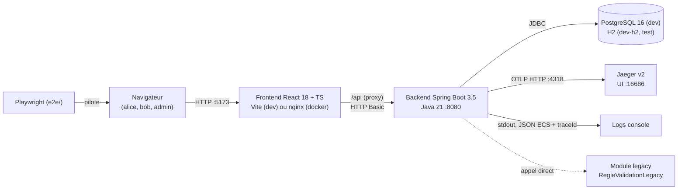
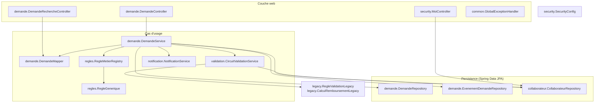
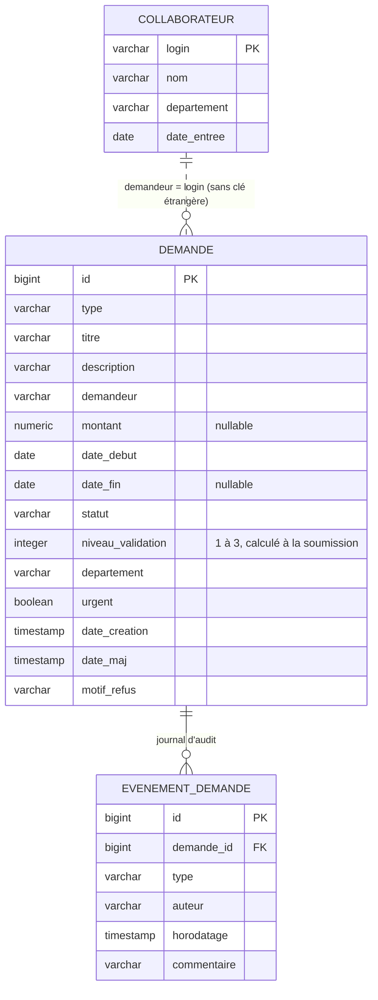
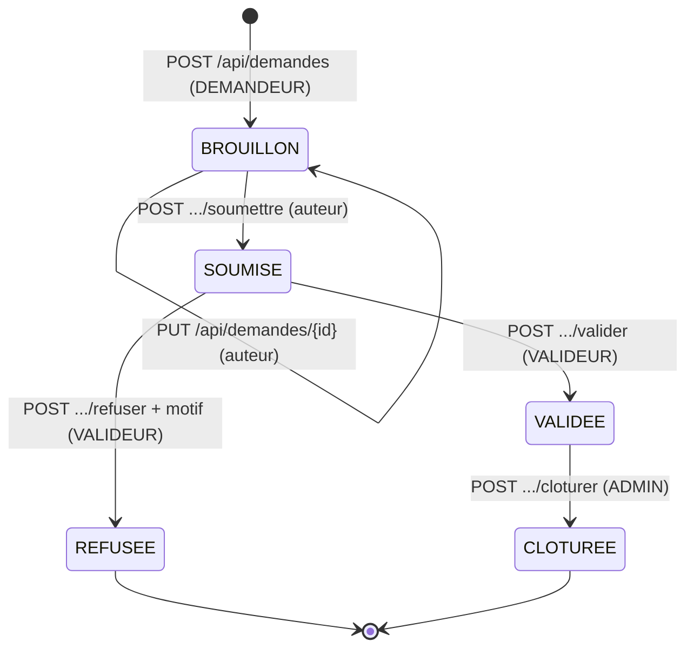
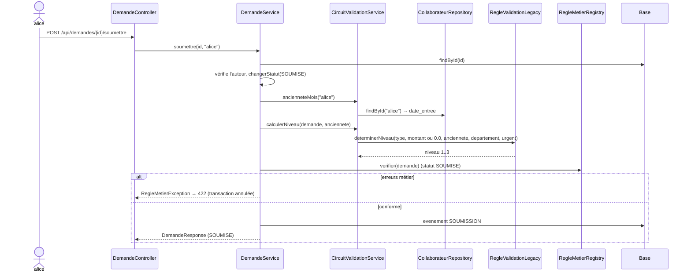

# Architecture de NeoFlow (socle)

Ce document décrit le socle tel qu'il est livré. Il est tenu à jour à chaque modification structurante (nouveau package, nouvelle table, nouvelle route) : une architecture documentée qui ne correspond plus au code est pire qu'une absence de documentation.

## 1. Vue d'ensemble

NeoFlow gère des demandes internes : création en brouillon, soumission, circuit de validation, clôture. Le socle traite toutes les demandes de façon générique ; chaque variante métier ajoute les règles de son type (`TypeDemande`).



| Élément | Technologie | Emplacement |
|---|---|---|
| Backend | Spring Boot 3.5.16, Java 21, Maven wrapper | `backend/` |
| Frontend | React 18.3, TypeScript 5.9, Vite 6, React Router 6 | `frontend/` |
| Tests E2E | Playwright 1.63 (TypeScript) | `e2e/` |
| Base | PostgreSQL 16 (profil `dev`), H2 2.3 en mode PostgreSQL (profils `dev-h2`, `test`) | `docker-compose.yml`, `backend/src/main/resources/` |
| Migrations | Flyway 10 | `backend/src/main/resources/db/migration/` |
| Traces | Micrometer Tracing (bridge OpenTelemetry) + exporteur OTLP vers Jaeger | `backend/pom.xml`, `application-dev.yml` |
| Documentation d'API | springdoc-openapi 2.8 : `/v3/api-docs`, `/swagger-ui.html` | `common/OpenApiConfig.java` |

## 2. Backend : packages et responsabilités

Racine : `backend/src/main/java/com/neosoft/neoflow/`.



| Package | Classes | Rôle |
|---|---|---|
| (racine) | `NeoflowApplication` | Point d'entrée ; bean `Clock` (horloge injectable) ; sérialisation des pages Spring Data en DTO (`VIA_DTO`) |
| `demande` | `Demande`, `StatutDemande`, `TypeDemande`, `TypeEvenement`, `EvenementDemande`, `DemandeRepository`, `EvenementDemandeRepository`, `DemandeService`, `DemandeController`, `DemandeRechercheController`, `DemandeMapper` | Domaine des demandes, cycle de vie, journal d'audit, API REST |
| `demande.dto` | `DemandeRequest`, `DemandeResponse`, `RefusRequest`, `EvenementResponse` | Contrats d'entrée et de sortie de l'API (records, Bean Validation sur les entrées) |
| `regles` | `RegleMetierDemande` (interface), `RegleMetierRegistry`, `RegleGenerique` | Point d'extension des variantes (voir §6) |
| `validation` | `CircuitValidationService` | Adaptateur vers le legacy : niveau de validation et ancienneté |
| `legacy` | `RegleValidationLegacy`, `CalculRemboursementLegacy` | Code historique, non testé, à ne pas modifier avant le J8 |
| `collaborateur` | `Collaborateur`, `CollaborateurRepository` | Référentiel simplifié : département et date d'entrée |
| `notification` | `NotificationService`, `NotificationProperties` | Notification du demandeur après validation ou refus ; inactive par défaut (`neoflow.notification.actif: false`), elle se contente alors de journaliser |
| `security` | `SecurityConfig`, `SecuriteProperties`, `MoiController` | HTTP Basic, comptes en mémoire, règles d'accès par rôle, utilisateur courant |
| `common` | `GlobalExceptionHandler`, `TransitionInvalideException`, `DemandeIntrouvableException`, `RegleMetierException`, `OpenApiConfig` | Traduction des erreurs en ProblemDetail, documentation OpenAPI |

Choix structurants (détaillés dans [ADR-000](../adr/ADR-000-fondation-socle.md)) : couches classiques contrôleur → service → repository ; le service renvoie des DTO ; les transitions de statut sont portées par l'énumération `StatutDemande` ; le legacy est isolé derrière un adaptateur.

## 3. Modèle de données

Schéma créé par `V1__schema.sql`, données de démonstration par `V2__donnees_demo.sql` (SQL compatible PostgreSQL et H2 `MODE=PostgreSQL`). Hibernate vérifie le schéma au démarrage (`ddl-auto: validate`) : toute évolution passe par une nouvelle migration `V3__...`.



- `demande.demandeur` contient le login ; il n'y a pas de clé étrangère vers `collaborateur`, pour qu'une variante puisse ajouter des comptes sans référentiel.
- `demande.departement` vaut par défaut le département du collaborateur, et peut être fourni dans la requête.
- Les identifiants explicites des données de démonstration sont suivis d'un `ALTER TABLE ... RESTART WITH 100` : les demandes créées ensuite commencent à 100.
- Données de démonstration : 9 collaborateurs (alice COMMERCIAL, bob FINANCE, admin DSI, chloe DSI, karim RH, claire DSI, david RH, emma MARKETING, farid ACHATS), 12 demandes d'alice couvrant tous les statuts, 29 événements.

## 4. Cycle de vie d'une demande



- Les transitions autorisées sont définies dans `StatutDemande.TRANSITIONS` et vérifiées par `Demande.changerStatut`. Toute autre transition lève `TransitionInvalideException` → **409**.
- La modification (`PUT`) n'est possible qu'au statut `BROUILLON`, sinon **409**.
- Modifier ou soumettre la demande d'un autre utilisateur → **403** (`AccessDeniedException` levée par le service).
- Chaque création, soumission, validation, refus et clôture écrit une ligne dans `evenement_demande` (`TypeEvenement` : `CREATION`, `SOUMISSION`, `VALIDATION`, `REFUS`, `CLOTURE`). La modification d'un brouillon n'est pas journalisée.
- Le circuit du socle comporte **un seul** valideur, quel que soit `niveauValidation` ; le niveau est calculé, enregistré et affiché.

## 5. Soumission : calcul du niveau de validation



`CircuitValidationService.calculerNiveau` convertit le montant `BigDecimal` (facultatif) en `Double`, en passant `0.0` quand il est absent, puis délègue au legacy. L'ancienneté est le nombre de mois révolus entre `collaborateur.date_entree` et la date du jour (horloge `Clock`) ; elle vaut 0 pour un login absent du référentiel.

## 6. Point d'extension des variantes

```java
public interface RegleMetierDemande {
    TypeDemande type();               // GENERIQUE = s'applique à toutes les demandes
    List<String> verifier(Demande d); // liste vide si conforme
}
```

- Toute implémentation annotée `@Component` est collectée par `RegleMetierRegistry` (injection de `List<RegleMetierDemande>`) : aucun enregistrement manuel.
- Le registre applique d'abord les règles `GENERIQUE`, puis celles du type de la demande, et concatène les messages.
- Moments d'appel : création et modification (demande au statut `BROUILLON`), soumission (demande au statut `SOUMISE`, `niveauValidation` calculé, pas encore enregistrée). Une règle distingue ces moments par `d.getStatut()`.
- Des erreurs produisent une `RegleMetierException`, rendue en **422** avec la propriété `erreurs`.
- `RegleGenerique` (socle) : la date de fin, si elle est renseignée, ne précède pas la date de début ; le montant, s'il est renseigné, est strictement positif.

## 7. API REST

| Méthode | Chemin | Rôle | Effet | Réponses |
|---|---|---|---|---|
| GET | `/api/demandes?statut=&type=&page=0&size=20` | authentifié | Liste paginée, page **0-based**, tri par date de création décroissante ; `size` de 1 à 100 | 200, 400 |
| GET | `/api/demandes/{id}` | authentifié | Détail | 200, 404 |
| GET | `/api/demandes/recherche?q=` | authentifié | Recherche par titre (50 résultats au plus, sans pagination) | 200 |
| POST | `/api/demandes` | DEMANDEUR | Crée en `BROUILLON` (`Location` renseigné) | 201, 400, 403, 422 |
| PUT | `/api/demandes/{id}` | DEMANDEUR (auteur) | Modifie un brouillon | 200, 400, 403, 404, 409, 422 |
| POST | `/api/demandes/{id}/soumettre` | DEMANDEUR (auteur) | `SOUMISE`, calcule `niveauValidation` | 200, 403, 404, 409, 422 |
| POST | `/api/demandes/{id}/valider` | VALIDEUR | `VALIDEE` | 200, 403, 404, 409 |
| POST | `/api/demandes/{id}/refuser` | VALIDEUR | `REFUSEE`, corps `{"motif": "..."}` obligatoire | 200, 400, 403, 404, 409 |
| POST | `/api/demandes/{id}/cloturer` | ADMIN | `CLOTUREE` | 200, 403, 404, 409 |
| GET | `/api/demandes/{id}/evenements` | authentifié | Historique chronologique | 200, 404 |
| GET | `/api/moi` | authentifié | `{login, roles, departement}` (utilisé par le frontend) | 200 |

Sans identifiants valides : **401**. Les règles d'accès par rôle sont déclarées dans `SecurityConfig` (par méthode HTTP et chemin) ; le contrôle « auteur de la demande » est fait dans `DemandeService`.

**Corps de création ou de modification** (`DemandeRequest`) :

```json
{ "type": "NOTE_DE_FRAIS", "titre": "Déjeuner client Lyon", "description": "…",
  "montant": 86.40, "dateDebut": "2026-10-08", "dateFin": null,
  "departement": null, "urgent": false }
```

`type`, `titre` (120 caractères au plus) et `dateDebut` sont obligatoires ; `montant` a au plus 2 décimales.

**Page de résultats** (format Spring Data `PagedModel`) :

```json
{ "content": [ { "id": 1, "type": "GENERIQUE", "statut": "BROUILLON", "...": "..." } ],
  "page": { "size": 20, "number": 0, "totalElements": 12, "totalPages": 1 } }
```

**Erreurs** : ProblemDetail (RFC 9457, `application/problem+json`) produit par `GlobalExceptionHandler`.

| Statut | `title` | Propriétés ajoutées |
|---|---|---|
| 400 | `Requête invalide` (Bean Validation) | `erreurs` : `"champ : message"` |
| 403 | `Accès refusé` (contrôle d'auteur) | — |
| 404 | `Demande introuvable` | — |
| 409 | `Transition de statut invalide` | — |
| 422 | `Règles métier non respectées` | `erreurs` : messages des règles |
| 500 | `Erreur interne` | `traceId` de la requête |

## 8. Sécurité

- HTTP Basic, sans session (`STATELESS`), CSRF désactivé (identifiants envoyés à chaque requête dans l'en-tête `Authorization`, pas de cookie).
- Comptes de démonstration déclarés dans `application.yml` (`neoflow.securite.utilisateurs`), mot de passe `neoflow` : `alice` (DEMANDEUR), `bob` (VALIDEUR), `admin` (ADMIN). Pas de hiérarchie de rôles : `admin` ne valide pas, `bob` ne crée pas.
- Le frontend envoie `X-Requested-With: XMLHttpRequest` : Spring Security répond alors 401 sans en-tête `WWW-Authenticate`, ce qui évite la fenêtre d'authentification native du navigateur.
- Accessibles sans authentification : `/actuator/health`, `/actuator/info`, `/v3/api-docs/**`, `/swagger-ui/**`, `/swagger-ui.html`, `/error`. Toute autre route hors `/api/**` est refusée.

## 9. Observabilité

- **Logs** : format structuré ECS sur la console (`logging.structured.format.console: ecs`) dans les profils `dev` et `dev-h2` ; chaque ligne émise pendant une requête porte `traceId` et `spanId`. Une exception non prévue est journalisée par `GlobalExceptionHandler` (niveau ERROR, champs `error.type`, `error.message`, `error.stack_trace`), et la réponse 500 renvoie le même `traceId`. Le profil `test` garde le format texte lisible.
- **Traces** : Micrometer Tracing (bridge OpenTelemetry), échantillonnage 100 % (`management.tracing.sampling.probability: 1.0`). Export OTLP HTTP vers `management.otlp.tracing.endpoint`, défini dans le profil `dev` (`OTLP_TRACING_ENDPOINT`, par défaut `http://localhost:4318/v1/traces`). Le profil `dev-h2` n'exporte pas. Les traces se consultent dans Jaeger : http://localhost:16686, service `neoflow-backend`.
- **Actuator** : `/actuator/health` et `/actuator/info` publics ; `/actuator/metrics` réservé au rôle ADMIN (voir `management.*` dans `application.yml`).

## 10. Profils et configuration

| Profil | Base | Traces exportées | Logs | Usage |
|---|---|---|---|---|
| `dev` (défaut) | PostgreSQL `jdbc:postgresql://localhost:5432/neoflow` (`DB_URL`, `DB_USER`, `DB_PASSWORD`) | oui, vers Jaeger | ECS | `make infra` puis `make backend`, ou `make up` |
| `dev-h2` | H2 en mémoire, recréée à chaque démarrage | non | ECS | `make backend-h2` (poste sans Docker) |
| `test` | H2 en mémoire | non | texte | tests d'intégration (`@ActiveProfiles("test")`) |

Fichiers : `application.yml` (commun), `application-dev.yml`, `application-dev-h2.yml`, `application-test.yml`.

## 11. Frontend

```
frontend/src/
├── main.tsx, App.tsx          routes : /connexion, /demandes, /demandes/nouvelle, /demandes/:id, /demandes/:id/modifier
├── api/client.ts              types de l'API, appels fetch sur /api, identifiants Basic en sessionStorage
├── auth/auth.ts, AuthProvider.tsx   utilisateur courant (GET /api/moi), rôles, déconnexion
├── components/                Layout, RouteProtegee, StatutBadge, MessageErreur, statuts.ts
├── pages/                     LoginPage, DemandesListe, DemandeFormulaire, DemandeDetail (+ tests Vitest)
├── legacy/utils-legacy.js     NeoUtils (ES5) : formatMontant, formatDate, joursOuvres
└── test/                      configuration Vitest et utilitaire de rendu
```

- Liste : filtres statut et type, recherche par titre, pagination (5, 10 ou 20 par page, 10 par défaut).
- Détail : actions selon le rôle et le statut (Modifier et Soumettre pour l'auteur d'un brouillon, Valider et Refuser pour le valideur, Clôturer pour l'admin), historique des événements.
- Formatage des montants et des dates par `NeoUtils` (import par défaut de `../legacy/utils-legacy.js`).
- En développement, Vite (port 5173) relaie `/api` vers `http://localhost:8080` (variable `VITE_API_PROXY` pour changer la cible). En docker, nginx relaie `/api` vers le service `backend`.

## 12. Tests

| Suite | Type | Commande | Contenu |
|---|---|---|---|
| `DemandeServiceTest` | unitaire, Mockito | `./mvnw test` | Création, soumission, validation, refus, clôture, transitions refusées, contrôle d'auteur, liste paginée |
| `RegleMetierRegistryTest` | unitaire | `./mvnw test` | Sélection des règles par type, agrégation, `RegleGenerique` |
| `DemandeControllerIT` | intégration (MockMvc, H2, sécurité réelle) | `./mvnw verify` | Authentification, rôles, validation 400, règles 422, circuit complet, 404, 409 en ProblemDetail |
| `src/**/*.test.ts(x)` | unitaire frontend, Vitest + Testing Library | `npm test` | Client API, liste, actions du détail selon le rôle |
| `e2e/tests/parcours-demande.spec.ts` | bout en bout, Playwright | `make e2e` | alice crée une demande GENERIQUE sans montant et la soumet ; bob la valide |

Couverture backend : rapports JaCoCo dans `backend/target/site/jacoco/` (unitaires) et `jacoco-it/` (intégration) après `./mvnw verify`. Frontend : `npm run test:coverage`.

Le module `legacy/` n'a aucun test : il est caractérisé au J8.

## 13. Intégration continue

`.github/workflows/ci.yml` : sur `push` vers `main` et sur `pull_request`, deux jobs (backend : `./mvnw -B verify` ; frontend : `npm ci`, `lint`, `test`, `build`). Les contrôles de sécurité sont ajoutés en J2.
