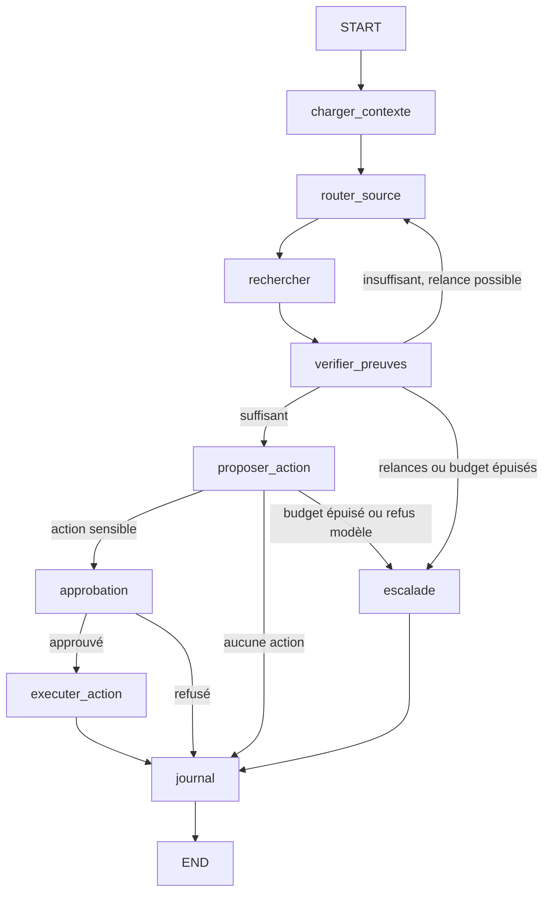

# Lab workflow (J09) — mémoire gouvernée, LangGraph résilient, réindexation incrémentale

Laboratoire du Jour 9 : une infrastructure complète et testée, dans laquelle vous **branchez le code que vous écrivez
en TP** (`extensions/`, voir plus bas). Tout fonctionne **sans clé API** avec `--offline` (modèle simulé déterministe)
et **sans Qdrant ni Ollama** (repli BM25 local, index simulé).

| Fichier | Rôle |
|---|---|
| `workflow.py` | Graphe LangGraph : routage de source, recherche, vérification des preuves, proposition, `interrupt` d'approbation, action idempotente, journal. Checkpoints SQLite. |
| `memoire.py` | Mémoire sémantique / épisodique / procédurale avec portée, provenance `fichier@commit`, empreinte de l'extrait cité, expiration, invalidation et relocalisation via `git diff`. |
| `sources.py` | Agentic RAG : règles de routage, 6 sources (symboles, lexical, vectoriel, hybride, documents, git), timeouts, dégradation si le lab RAG est absent, contrôle de fraîcheur. |
| `llm.py` | Décisions LLM isolées : `CerveauClaude` (Haiku 5.5 / Sonnet 5.5 via langchain-anthropic) ou `CerveauSimule` (offline). |
| `reindex_incremental.py` | Pipeline déterministe Git → extraction → index → validation (`plan`, `appliquer`, `valider`, `tout`). |
| `kestra/reindex-incremental.yml` | Le même pipeline orchestré par Kestra, déclenché par webhook de push. |
| `extensions.py` | Points d'extension : vos composants (TP1 à TP4) remplacent ceux du lab via `--config`. |
| `neoagent_pont.py` | Action `deleguer_neoagent` : délégation d'une analyse en lecture seule à l'agent du J4 (`labs/agent`). |
| `config.yaml` | Modèles, budget, limites, retries, seuils de preuves, actions sensibles, motifs d'indexation. |
| `tests/` | 84 tests offline (dépôt Git jetable) : reprise, idempotence, retries, timeout, budget, invalidation, extensions, neoagent, Kestra. |

## Installation

```bash
cd labs/workflow
uv sync                                  # crée .venv (non versionné) avec langgraph, langchain-anthropic...
uv run pytest                            # 84 tests, environ 20 s, aucun réseau
export ANTHROPIC_API_KEY=sk-ant-...      # clé Neosoft, uniquement pour le mode réel
```

Versions vérifiées à la rédaction : `langgraph 1.2`, `langgraph-checkpoint-sqlite 3.1`, `langchain-anthropic 1.7`, Python 3.12.

## Démarrage rapide (offline)

```bash
uv run python workflow.py lancer --offline --thread nf-402 --ticket NF-402 --demandeur alice \
  --question "Où est calculé le niveau de validation dans CircuitValidationService ?"
# -> EN ATTENTE D'APPROBATION : commenter_ticket -> NF-402 (aucun effet n'a eu lieu)

uv run python workflow.py approuver --offline --thread nf-402 --approbateur bob --crash-apres-effet
# -> le processus est tué juste après l'effet, avant le checkpoint du nœud (code 137)

uv run python workflow.py reprendre --offline --thread nf-402
# -> reprise depuis le checkpoint ; « effet déjà appliqué (clé connue) : ignoré »

uv run python workflow.py journal --thread nf-402       # journal de reprise
uv run python workflow.py historique --thread nf-402    # checkpoints (time travel)
uv run python workflow.py commentaires --ticket NF-402  # un seul commentaire
```

Par défaut le dépôt analysé est celui qui contient le lab (NeoFlow) et l'état est écrit dans `labs/workflow/.etat/`
(ignoré par Git). Options communes : `--depot`, `--etat` (ou `$NEOFLOW_ETAT`), `--config`, `--offline` (ou `NEOFLOW_OFFLINE=1`).

## Commandes

| Commande | Effet |
|---|---|
| `lancer --thread T --question Q [--ticket NF-n] [--demandeur login] [--action deleguer_neoagent]` | Démarre un thread (refusé si le thread existe déjà). |
| `approuver --thread T --approbateur login [--decision approuver\|refuser\|modifier] [--contenu ...]` | Répond à l'`interrupt`. Toute réponse mal formée, un approbateur absent, `agent:*` ou égal au demandeur vaut **refus**. |
| `reprendre --thread T` | Relance depuis le dernier checkpoint après crash ou erreur. Refusé si une approbation est en attente. |
| `rejouer --thread T --checkpoint ID` | Fork depuis un checkpoint passé (time travel). Ne rejoue pas les effets grâce à la clé. |
| `annuler --thread T` | Rollback métier : applique les compensations enregistrées (idempotent). |
| `etat`, `historique`, `journal [--thread T]`, `commentaires --ticket X`, `graphe` | Lecture seule. |
| Options de simulation | `--panne-retriever N`, `--lenteur-s X`, `--crash-apres-effet`, `--sans-idempotence`. |

## Brancher votre code (TP du J9)

```bash
cp -r <supports>/J09_memoire_workflows/exercises/starters/extensions .     # modules à compléter + tests
uv run pytest extensions/tests                                              # rouges tant que les TODO restent
uv run python workflow.py lancer --offline ... --config extensions/config.extensions.yaml
```

| Clé `extensions` | Signature | Remplace |
|---|---|---|
| `politique_memoire` | `(type, contenu, portee, source) -> None`, lève `MemoireRefusee` | `memoire.politique_par_defaut` |
| `verdict_souvenir` | `(extrait, debut, fin, empreinte, contenu_nouveau) -> (verdict, debut, fin)` | `memoire.verdict_souvenir` |
| `routeur` | `(question) -> (source | None, motif)` | `sources.router_heuristique` |
| `source_suivante` | `(derniere, essayees) -> source | None` | `sources.source_suivante` |
| `noeuds` | module : `approbation(etat, config, ctx)`, `executer_action(etat, config, ctx)`, `apres_verification(etat, ctx)` | nœuds du graphe |
| `classer_changements` | `(changements, est_inclus, taille, taille_max) -> plan` | `reindex_incremental.classer_changements` |

Chemins relatifs au fichier de configuration (`fichier.py:fonction`) ; `null` garde la référence du lab. Pour un nœud
d'action branché, le lab ajoute lui-même le crash simulé après votre nœud. Primitives offertes : `ctx.effets.deja_applique`,
`ctx.effets.appliquer_et_enregistrer` (effet + registre en une transaction), `ctx.journal.evt`, `workflow.empreinte_action`.

## Déléguer à `neoagent` (J4)

```bash
uv run python workflow.py lancer --offline --thread d1 --demandeur alice --action deleguer_neoagent \
  --question "Comment CircuitValidationService traite-t-il un montant nul ?"
uv run python workflow.py approuver --offline --thread d1 --approbateur bob
```

- Contrat neoagent : `neoagent.tools.outils_de_base(repo, politique)` et `neoagent.agent.Agent(...).executer(tache)`, importés
  de façon tolérante depuis `neoagent.chemin_lab` (`../agent`). Les classes annexes (Politique, Approbateur, Journal) sont
  passées seulement si le constructeur les attend.
- Seuls les outils de risque `lecture` sont transmis ; la délégation est une **action sensible** (approbation requise).
- Appel externe non transactionnel : journal d'intention avant l'appel, résultat inscrit au registre ensuite ; après un
  crash, le rejeu reconnaît la clé et ne relance pas l'agent (test `test_delegation_rejouee_apres_crash_sans_second_appel`).
- `labs/agent` absent, d'une autre API ou encore incomplet (boucle du J4 en `TODO`) : résultat `indisponible`, le
  workflow escalade sans effet. Vérifié aussi contre le corrigé J04 de `neoagent` en offline.

## Graphe



`uv run python workflow.py graphe` produit le Mermaid réel du graphe compilé.

## Garanties et où elles sont implémentées

| Garantie | Mécanisme | Test |
|---|---|---|
| État durable | `SqliteSaver` + `durability="sync"` (checkpoint écrit avant le super-step suivant) | `test_crash_apres_effet_puis_reprise...` |
| Aucune action sensible sans approbation | `interrupt()` dans `approbation`, revérification décision + empreinte dans `executer_action` | `test_action_alteree_apres_approbation_bloquee` |
| Pas de double exécution | clé `hash(thread, action)` + effet et registre dans la même transaction + contrainte `UNIQUE` | `test_sans_idempotence_la_reprise_duplique_l_effet` (contre-exemple) |
| Tentatives bornées | `RetryPolicy(max_attempts=3, retry_on=ErreurTransitoire)` sur `rechercher` et `proposer_action` | `test_retries_bornes_puis_reprise_apres_erreur` |
| Timeout | `subprocess(timeout=)` pour git, timeout côté appelant pour le lab RAG | `test_timeout_de_source_borne_la_duree` |
| Budget | compteur d'appels LLM et de tokens dans l'état ; épuisé → escalade | `test_budget_llm_epuise_escalade_sans_appel` |
| Filet de sécurité | `recursion_limit` (25) | `test_recursion_limit_filet_de_securite` |
| Connaissance obsolète écartée | fraîcheur des preuves (commit d'indexation vs HEAD), invalidation et lecture défensive de la mémoire | `test_memoire_obsolete_ecartee_du_contexte_du_workflow` |

LangGraph 1.2 propose aussi `add_node(..., timeout=...)` (nœuds **async** uniquement) et `error_handler=` : le lab reste
synchrone et ne les utilise pas, pour rester lisible et compatible avec `SqliteSaver` synchrone.

## Mémoire

```bash
uv run python memoire.py ajouter --type semantique --portee projet:neoflow \
  --contenu "CircuitValidationService convertit un montant nul en 0.0" \
  --source backend/src/main/java/com/neosoft/neoflow/validation/CircuitValidationService.java@HEAD:31-31
uv run python memoire.py lister --portee projet:neoflow --tous
uv run python memoire.py invalider --depuis HEAD~1          # après un changement Git
uv run python memoire.py exporter --portee projet:neoflow --revalider   # Markdown revalidé au commit courant
```

Refus à l'écriture : fait ou procédure sans provenance, provenance invérifiable, portée invalide, contenu ressemblant
à un secret. `HEAD` est toujours résolu en SHA. TTL par défaut : épisodique 30 j, sémantique 90 j, procédurale sans TTL.

## Intégration avec le lab RAG (J05)

Contrat vérifié sur `labs/rag` (indexation réelle fastembed + Qdrant embarqué testée pendant la rédaction) :

| Usage | API J05 appelée | Côté J09 |
|---|---|---|
| Recherche | `Searcher(config_path=rag.config).search(q, mode, k, source_type=...)`, modes `bm25`, `vector`, `hybrid` | `sources.py` (`MODES_RAG`) ; `documents` filtre `source_type="doc"` |
| Fraîcheur | champ `stale` des résultats, `commit` court ou `+dirty` | `verifier_preuves` écarte la preuve avec motif |
| Indisponibilité | `IndexMissingError` (OSError), `BackendUnavailableError` (ConnectionError) | dégradation tracée vers BM25 local |
| Réindexation | `indexer.run_index(cfg, incremental=True, quiet=True)` | `IndexLabRagJ05` dans `reindex_incremental.py` |
| Validation | `rag_common.read_manifest`, `select_corpus`, `sha256_text` | chaque fichier du plan comparé au contenu à la cible |

- L'indexeur J05 lit **l'arbre de travail** : HEAD doit être la cible (c'est le cas dans le clone Kestra).
- Il indexe le dépôt de `labs/rag/config.yaml` (`repo_root`) ou `NEOFLOW_REPO_ROOT` : si ce n'est pas le dépôt
  passé à `--depot`, le pipeline bascule en index simulé et le dit (`raison_index`).
- Fichiers hors liste blanche J05 : signalés dans `infos`, pas en erreur.
- **Repli** si le lab est absent, non installé ou incohérent : BM25 local et index simulé `.etat/index_simule.json`.
  Forcer le repli : `NEOFLOW_RAG=off` ou `rag.activer: non`. Pour utiliser le RAG réel depuis le lab workflow,
  installer aussi les dépendances du lab RAG dans le même environnement (`uv pip install -r ../rag/pyproject.toml`).

## Réindexation incrémentale et Kestra

```bash
uv run python reindex_incremental.py --simulation tout                 # premier passage : complet
uv run python reindex_incremental.py --simulation tout                 # rien à faire (idempotent)
uv run python reindex_incremental.py --simulation plan --depuis HEAD~1 --sortie plan.json
```

Le flow `kestra/reindex-incremental.yml` appelle les mêmes étapes (`plan`, `appliquer`, `valider`) et stocke le dernier
commit indexé dans le KV store Kestra. Il est écrit pour **Kestra 1.x** et a été validé **structurellement**
(`tests/test_kestra_flow.py`), pas exécuté sur une instance : à valider dans l'éditeur Kestra ou avec
`kestra flow validate` sur la version du laboratoire. Démarrage local documenté par Kestra (à vérifier selon version) :

```bash
docker run --pull=always --rm -it -p 8080:8080 --user=root \
  -v /var/run/docker.sock:/var/run/docker.sock -v /tmp:/tmp kestra/kestra:latest server local
```

Secrets attendus : `GIT_USERNAME`, `GIT_TOKEN`, `QDRANT_URL`, `OLLAMA_HOST` ; remplacer la clé du webhook.

## Dépannage

| Symptôme | Cause probable | Action |
|---|---|---|
| `ANTHROPIC_API_KEY absente` | mode réel sans clé | exporter la clé ou ajouter `--offline` |
| `le thread ... existe déjà` | `lancer` sur un thread connu | `reprendre`, `etat`, ou un autre `--thread` |
| `ÉCHEC après 3 tentative(s)` | source en panne (ou `--panne-retriever`) | corriger puis `reprendre` : le checkpoint est conservé |
| `dégradations : vectoriel indisponible` | lab RAG absent ou Qdrant éteint | normal en offline ; démarrer `docker compose --profile ia up` sinon |
| `réindexation déjà en cours` (code 3) | verrou `.etat/reindex.lock` | attendre ; un verrou de plus d'une heure est repris |
